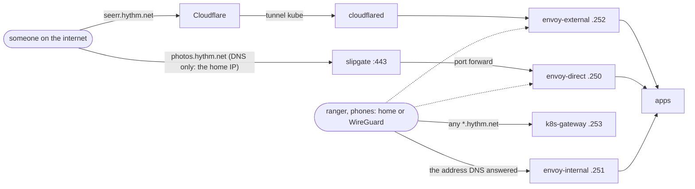

# networking

How a request reaches an app. Apps don't get their own addresses: three Envoy gateways on
`gloom` (VLAN 20) take every request, and the hostname picks the app.

| Address | What |
|---|---|
| 10.1.20.250 | `envoy-direct`: from the internet straight to home, for big or private traffic |
| 10.1.20.251 | `envoy-internal`: home and WireGuard only |
| 10.1.20.252 | `envoy-external`: from the internet through the Cloudflare tunnel |
| 10.1.20.253 | `k8s-gateway`: DNS for `hythm.net` at home |
| 10.1.20.254 | `qube.internal`, the Kubernetes API (kube-vip) |

Cilium announces all of them to slipgate over BGP; none is on vore's own cable.

## Three ways in



- **`envoy-external`**, the default for public apps. Cloudflare hides the home IP and filters
  attacks, but it caps uploads at 100 MB, decrypts the traffic, and forbids video streaming.
  external-dns publishes these hostnames as proxied (orange cloud) records to the tunnel.
- **`envoy-direct`**, for what Cloudflare can't or shouldn't carry: video (Jellyfin), big uploads
  (Immich, Paperless), private content (Pocket ID, Open WebUI). The record is DNS only (grey
  cloud): a CNAME to `direct.hythm.net`, which `cloudflare-ddns` keeps on the WAN address.
  slipgate forwards port 443 to `.250` (alias `KubeDirect`), and CrowdSec checks every request.
  Routes need `external-dns.kubernetes.io/cloudflare-proxied: "false"`.
- **`envoy-internal`**, for everything else: admin pages and the media tools. It has no public
  record at all.

**At home every name stays home.** slipgate forwards `hythm.net` lookups to `k8s-gateway`, which
answers each hostname with its gateway's address, so `seerr.hythm.net` at home goes straight to
`.252`, never out to Cloudflare and back. An "SSL error" at home is usually this DNS, not the app.

## Which app is where

Read it from the cluster rather than from a list here:

```sh
kubectl get httproute -A --sort-by=.spec.parentRefs[0].name \
  -o custom-columns=GATEWAY:.spec.parentRefs[0].name,HOST:.spec.hostnames[0],NAMESPACE:.metadata.namespace
```

A new app goes on `envoy-internal` unless people outside need it; then `envoy-external`, or
`envoy-direct` when it streams video, takes big uploads or holds private data.

## Also here

- `cloudflared`: the tunnel `kube` behind `envoy-external`
- `cloudflare-ddns`: keeps `direct.hythm.net` on the WAN address
- `crowdsec`: blocks known attackers on `envoy-direct`
- `external-dns`: publishes HTTPRoute hostnames to Cloudflare (owner `qube`)
- `k8s-gateway`: the home DNS above
- `multus`: vore's extra legs on `house` (IoT) and `ziggurat` (VPN egress for qbittorrent)
- `smtp-relay`: mail from apps, through Migadu as `noreply@hythm.net`
